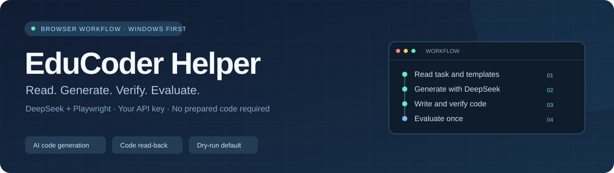

<p align="center">
  
</p>

<p align="center">
  <a href="https://github.com/Zyandiel/EduCoder-AutoSubmit/releases/latest"></a>
  <a href="https://github.com/Zyandiel/EduCoder-AutoSubmit/actions/workflows/tests.yml"></a>
  
  
  <a href="LICENSE"></a>
</p>

<p align="center">
  <b>配置 DeepSeek API Key、登录头歌，自动读取题目、生成代码并逐关评测。</b><br>
  无需提前准备 CPP 文件 · 自动发现新作业 · 多文件模板 · 默认 dry-run
</p>

<p align="center">
  <a href="#快速开始">快速开始</a> · <a href="docs/usage.md">使用指南</a> · <a href="docs/troubleshooting.md">常见问题</a> · <a href="CONTRIBUTING.md">参与贡献</a>
</p>

## 它能做什么

EduCoder Helper 使用 Playwright 操作浏览器，将当前可访问的题目说明和代码模板交给 DeepSeek 生成解答，写入编辑器后逐字回读，再运行一次评测。新作业默认自动发现，不需要手动创建答案目录或维护作业名单。

| 能力 | 当前支持 |
| --- | --- |
| 首次启动引导 | API Key 配置、登录、从浏览器获取课程地址 |
| 会话恢复与分页 | 恢复登录，读取全部作业分页，跳过已完成关卡 |
| AI 解题 | 读取题目与模板；生成单文件或多文件解答 |
| 在线代码校验 | 备份原代码，写入后完整回读，校验一致再评测 |
| 失败隔离 | 每关单次评测，失败记录后继续其他作业 |
| 本地代码模式 | 继续支持已有 `N.cpp` 与文件映射 |
| 最终提交作业 | **暂未开放**；`submit` 返回退出码 2 |

> **dry-run 仍会修改在线代码并运行评测，平台可能同步更新进度和成绩。** 它限制的是最终“提交作业”。当前适配已核实的 Monaco 页面；缺少题目上下文、访问受限或 DOM 改版时会记录原因，不能保证任意题目都能通过。

## 快速开始

需要 **Windows、Python 3.11+**、可用的 **DeepSeek API Key**，以及你有权访问的 EduCoder 课程。启动器优先使用已安装的 Chrome 或 Edge，均未安装时下载 Playwright Chromium。生成代码会使用你的 DeepSeek API 额度。

### 1. 获取项目

推荐下载 [v0.3.0 源码 ZIP](https://github.com/Zyandiel/EduCoder-AutoSubmit/archive/refs/tags/v0.3.0.zip)，解压后双击 `START.cmd`。这是 Python 源码发行版，需要先安装 Python 3.11+。

也可以使用 Git：

```powershell
git clone https://github.com/Zyandiel/EduCoder-AutoSubmit.git
cd EduCoder-AutoSubmit
```

也可使用仓库的 **Code → Download ZIP**，解压后打开文件夹。

### 2. 双击 START.cmd

启动器准备 Python 环境和依赖，然后进入首次配置引导：

1. 按提示输入 DeepSeek API Key；输入不回显，Windows 使用当前用户的 DPAPI 加密后保存在本机。
2. 在打开的浏览器中登录头歌、完成验证，打开目标课程的“实训作业”页面。
3. 按终端提示确认，程序保存会话和课程地址，开始处理未完成作业。

**无需准备 CPP 文件，也无需编辑作业名单。** 已有课程配置和有效会话会直接复用。以后有新任务，再次双击 **START.cmd** 即可。

运行时请避免使用系统剪贴板、编辑自动化浏览器或切换在线文件；代码填写和回读会临时使用剪贴板，结束后恢复原文本。

### 3. 查看结果

终端显示当前作业、关卡和评测结果。`logs/auto-summary.json` 保存本次处理范围；`logs/run-*/report.json` 记录逐关结果，对应目录保存题目、生成代码、原代码和错误信息。

AI 生成不等于评测通过。失败或超时后，本次运行不会自动反复提交同一关；修正问题后可再次启动。

## 命令一览

在项目目录执行；以下 `python` 代表 `.\.venv\Scripts\python.exe`。

| 命令 | 作用 |
| --- | --- |
| `python main.py start` | 首次引导，并开始自动解题与评测 |
| `python main.py setup` | 配置或更换 API Key；课程尚未设置时引导选择 |
| `python main.py login --fresh` | 手动重新登录并保存会话 |
| `python main.py list` | 列出课程作业与进度 |
| `python main.py auto --check` | 检查配置与 Key 是否可读取，不调用 API 或打开浏览器 |
| `python main.py auto` | 刷新所有分页，自动处理未完成作业 |
| `python main.py run --assignment "实训名称" --dry-run` | 刷新列表后，只处理指定实训 |
| `python main.py auto --local` | 使用已有本地代码，处理配置中启用的作业 |
| `python main.py inspect --assignment "实训名称" --enter` | 读取关卡、进入工作区并保存诊断 |

完整配置、环境变量、多文件模式和退出码见 [使用指南](docs/usage.md)。

## 项目结构

```text
ai/            DeepSeek 客户端、结果验证与 API Key 管理
browser/       浏览器会话与页面导航
educoder/      作业、题目模板、编辑器、评测与流程
tests/         单元测试及本地浏览器页面测试
examples/      本地代码模式的目录和文件映射示例
docs/          使用说明、故障排查与开发文档
.auth/         本机密钥及登录状态（被 Git 忽略）
solutions/     可选的本地代码（被 Git 忽略）
logs/          题目、生成代码及操作结果（被 Git 忽略）
```

## 开发与贡献

```powershell
python -m pip install -r requirements.txt
python -m playwright install chromium
python -m unittest discover -s tests -v
```

GitHub Actions 使用本地页面和模拟 API 验证流程，不使用真实账号或消耗 DeepSeek 额度。测试通过不代表任意线上题目都能通过。Windows 是主要支持平台。

欢迎通过 [Issue](https://github.com/Zyandiel/EduCoder-AutoSubmit/issues) 报告问题或提交 PR。请先阅读 [贡献指南](CONTRIBUTING.md)和 [安全说明](SECURITY.md)。

本项目与 EduCoder、DeepSeek 官方无关联；只操作账号已有权限的页面，验证码由用户完成。题目和模板会发送到 DeepSeek，网站密码、Cookie 和 storageState 不发送给模型。仓库不分发真实课程解答。

以 [MIT License](LICENSE) 发布。

从旧版本升级请阅读 [v0.3.0 发布说明](docs/releases/v0.3.0.md)：本版本默认启用 AI，原本地代码流程可通过 `--local` 保留。
