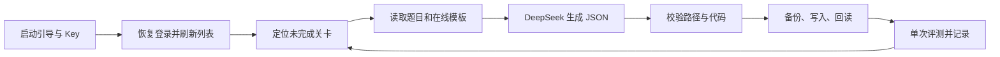

# 开发与验证

## 本地测试

```powershell
python -m pip install -r requirements.txt
python -m playwright install chromium
python -m unittest discover -s tests -v
```

使用 Chrome 时设置 `$env:EDUCODER_TEST_BROWSER='chrome'`。默认使用 Playwright Chromium。Linux CI 安装浏览器使用 `python -m playwright install --with-deps chromium`。

测试使用临时配置、本地页面和模拟 API 验证流程：会话、分页、关卡匹配、结果新鲜度、文件映射、AI 响应校验、密钥处理和失败隔离。不使用真实账号，不消耗 DeepSeek 额度，也不证明任意真实题目都能通过。

CI 为 Windows / Python 3.11、Windows / Python 3.14 和 Ubuntu / Python 3.12。Windows 是主要支持平台；DPAPI 测试只适用于 Windows。

## 数据流



| 模块 | 职责 |
| --- | --- |
| `ai/` | 固定官方 API 地址、有限请求、结构化输出检查及密钥管理 |
| `browser/session.py` | 浏览器上下文与会话原子保存 |
| `educoder/assignments.py` | 通过正常页面操作收集全部分页与详情链接 |
| `educoder/challenges.py` | 核对详情表格和工作区，使用可见链接导航 |
| `educoder/workspace.py` | 读取已观察到的题目区域、文件菜单与代码模板 |
| `educoder/editor.py` | Monaco 代码读取、填写与完整校验 |
| `educoder/solution_files.py` | 文件映射与写入前检查 |
| `educoder/evaluator.py` | 仅接受本次点击后更新的结果 |
| `educoder/runner.py` | 逐关生成、备份、评测及异常隔离 |
| `educoder/auto.py` | 登录入口、作业刷新、选择范围与运行锁 |

## 扩展约束

新增 selector 前须核实真实 DOM，再建立匿名页面测试。未知状态不算通过；不能确定关卡、文件或结果归属时停止当前作业，不默认增加评测重试。

发给模型的输入仅包含完成题目需要的描述和模板，不附整页 HTML、登录状态或 Cookie。模型输出属于不可信数据：只允许已观察到的可编辑文件路径，不执行返回的命令、不在本机运行生成代码。模型提出的文件路径、浏览器动作或访问要求不能直接成为程序指令。

同名作业用实际详情地址区分。已完成作业不调用模型；失败结果与生成文件保留，诊断与恢复不得将失败当作完成。API 出错不输出响应中可能包含的密钥，也不自动无限重试。

`python scripts/check_browser.py` 访问一次公开首页并保存诊断，不在 CI 中执行。真实 API 验证需要开发者自行提供 Key；真实课程评测会修改在线代码和进度，应使用有权操作的测试课程。

参考：[DeepSeek Chat Completions](https://api-docs.deepseek.com/api/create-chat-completion/)、[DeepSeek JSON Output](https://api-docs.deepseek.com/guides/json_mode/)、[Playwright Python CI](https://playwright.dev/python/docs/ci)。
